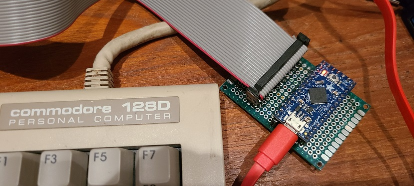
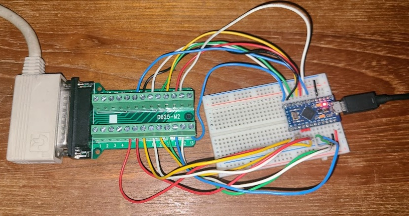

# Commodore 128 to USB keyboard HID driver #

## [Adafruit ItsyBitsy](https://learn.adafruit.com/introducting-itsy-bitsy-32u4/) version ##

# Xemu (Commodore Emulator) Positional keyboard mapping for MEGA65

PC(US) keyboard to Commodore MEGA65 keyboard positional mapping for Xemu (may require some adjustments)

                                     (LF....NoScroll)
          Esc F1 F2 F3 F4 F5 F6 F7 F8 F9 F10 F11 F12 F13 F14 F15 F16
           ←  1! 2" 3# 4$ 5% 6& 7' 8( 9) 0  -  =  Del     +  Home  Help     / * -
    Ctrl(Tab) Q  W  E  R  T  Y  U  I  O  P  @  *   ↑      £  Stop Restore 7 8 9 +
    Lock(Cap) A  S  D  F  G  H  J  K  L  ;] :[ Return                     4 5 6
    LShift    Z  X  C  V  B  N  M  ,< .> /?    RShift          Up         1 2 3
    C=(Ctrl)           SPACEBAR              C=(Ctrl)    Lft  Down  Rt    0 .   Enter

This hardware/software solution allows a Commodore 64, 128, or Vic-20 keyboard to be used as a USB HID keyboard.  The keyboard pin numbers are the same between all the Commodore systems (e.g. single inline pins for most with key at pin 2, or DB-25 for external keyboard with 128D). The use of ItsyBitsy allowed all the extra lines necessary to support the extra keys added for C128.  ItsyBitsy is an alternate form factor related to [Arduino Leonardo](https://docs.arduino.cc/hardware/leonardo) with all the extra lines of the 32U4 present.  The [ATmega32U4](https://www.microchip.com/en-us/product/atmega32u4) has the ability to directly act as a USB HID device in conjuction with the Arduino keyboard library.  Utilizing a DB-25 to 0.1" 2.54mm pitch dual row pin socket adapter for the first hand soldered and wired circuit board to make it both easier to build and semi-permanent.

Status: Working 88+ key solution. Multiple keys pressed on same row issue has been resolved (only one column output must be active at one time, otherwise change column to a HIGH-Z input to avoid competing low and high outputs). 

This repository contains multiple branch variants for different hardware and use cases.

### HID general use branches - for use with Windows, Mac, Android

* main - merge from ninetyone_hid_itsy_bitsy
* [ninetyone_hid_itsy_bitsy](https://github.com/davervw/c128_keyscan/tree/ninetyone_hid_itsy_bitsy) - working C128/C64/Vic-20 HID driver using Adafruit ItsyBitsy
* [sixtyfour_hid_pro_micro](https://github.com/davervw/c128_keyscan/tree/sixtyfour_hid_pro_micro) - working C128/C64/Vic-20 HID driver using Arduino Pro Micro

### HID VICE and Xemu positional use branches - for emulator-based builds using the 91-key Adafruit ItsyBitsy configuration
(WYSIWYG - what you see is what you get - using Vic-20, C64, C128 electrically compatible keyboards)

* [c64_vice_positional_hid_itsy_bitsy](https://github.com/davervw/c128_keyscan/tree/c64_vice_positional_hid_itsy_bitsy) - VICE C64 & Vic-20 positional HID driver
* [plus4_vice_positional_hid_itsy_bitsy](https://github.com/davervw/c128_keyscan/tree/plus4_vice_positional_hid_itsy_bitsy) - VICE plus/4 positional HID driver
* [c128_vice_positional_hid_itsy_bitsy](https://github.com/davervw/c128_keyscan/tree/c128_vice_positional_hid_itsy_bitsy) - VICE C128 positional HID driver
* [mega65_xemu_positional_hid_itsy_bitsy](https://github.com/davervw/c128_keyscan/tree/mega65_xemu_positional_hid_itsy_bitsy) - Xemu Mega65 positional HID driver

### Serial (active scan codes) branches

* [ninetyone_serial_itsy_bitsy](https://github.com/davervw/c128_keyscan/tree/ninetyone_serial_itsy_bitsy) - working C128 serial scancode 0..88 + RESTORE, CAPS, DISP reporter to USB serial using Adafruit ItsyBitsy
* [sixtyfour_serial_pro_micro](https://github.com/davervw/c128_keyscan/tree/sixtyfour_serial_pro_micro) - working C64 serial scancode 0..64 + RESTORE reporter to USB serial using Arduino Pro Micro
* [ninetyone_tx2_itsy_bitsy](https://github.com/davervw/c128_keyscan/tree/ninetyone_tx2_itsy_bitsy) - working C128 serial scancode 0..88 + RESTORE, CAPS, DISP reporter to software serial (pin 2, instead of I2C data) using Adafruit ItsyBitsy designed for wired connection to [M5Stack C64/C128 emulator](https://github.com/davervw/c-simple-emu6502-cbm/tree/m5) (M5CoreS3, etc.)
* [vic20_sixtyfour_serial_itsy_bitsy](https://github.com/davervw/c128_keyscan/tree/vic20_sixtyfour_serial_itsy_bitsy) - working Vic-20 serial scancode 0..64 + RESTORE reporter to USB serial using Adafruit ItsyBitsy (changing I/O pins to match Vic-20)
* [vic20_sixtyfour_serial_itsy_bitsy-xlat-from-c64](https://github.com/davervw/c128_keyscan/tree/vic20_sixtyfour_serial_itsy_bitsy-xlat-from-c64) - working Vic-20 serial scancode 0..64 + RESTORE reporter to USB serial using Adafruit ItsyBitsy (alternate converting scan codes internally from C64 to Vic-20)

Commodore Vic-20, 64, 128 keyboards are hardware compatible with the 128 adding additional columns and lines for an extra 26 keys.  But the Vic-20 scan code numbering is different because the lines are connected to the I/O chips in a different order, and the scan code is calculated differently.  In other words, the keyboards are interchangeable for these projects -- you only lose access to extra keys if you don't have them.

Notes:
    
    RESTORE key mapping not included in this iteration

    WARNING!!! wiring has changed between various commits. 
    Always review DB-25 to Arduino wiring instructions which are in source code comments.  

    C65 and Mega65 hardware keyboards not supported as a source for these HID/Serial solutions, they are not directly compatible with the Vic-20/C64/C128 keyboard lines.

Links

* [Reference C128 Keyboard @ zimmers](http://www.zimmers.net/anonftp/pub/cbm/schematics/computers/c128/servicemanuals/manual/51.gif)
* [Blog: Extremely small emulated C64](https://techwithdave.davevw.com/2023/06/extremely-small-emulated-c64.html)
